<!-- ============ $ ./perfil.sh ============ -->
<p align="center">
  
</p>

<p align="center">
  <a href="https://www.linkedin.com/in/antonioviniciusav"></a>
  
  
</p>

<br/>

<!-- ============ 01. sobre_mim() ============ -->


[](https://git.io/typing-svg)

<div align="justify">

Sou desenvolvedor web atuando no `Back-end` e no `Front-end`, cursando **Análise e Desenvolvimento de Sistemas** na **Faculdade Senac (Recife/PE)** e já colocando a mão na massa em projetos práticos de desenvolvimento **web e mobile**.
Faço parte do ecossistema do **Porto Digital**, o maior polo de inovação e tecnologia do Brasil, onde passei por **residências tecnológicas** com o **Banco do Brasil** e a **Liferay DXP** e fui reconhecido como **aluno destaque** em 2025.2 e 2026.1.
Antes do código, trabalhei com atendimento ao cliente na Ferreira Costa, o que me deu comunicação clara, oratória e um olhar sempre centrado na **experiência do usuário**.
No dia a dia uso `Node.js`, `Express`, `TypeScript`, `Python`, `Prisma` e `SQL`, e aplico **IA (LLMs)** no desenvolvimento de produtos digitais.
Tenho mentalidade prática, aprendo rápido e estou sempre em busca de novos desafios!

</div>

```diff
+ Construindo APIs com Node.js, Express e Prisma
+ Desenvolvendo apps full stack: BioAlert e Barbearia Digital
+ Aplicando IA (LLMs) em produtos digitais
+ Aberto a oportunidades e colaborações
- Bugs (estou trabalhando nisso)
```

<br clear="right"/>
<br/>

<!-- ============ 02. tecnologias() ============ -->

<p align="center">
  
</p>

<p align="center">
  
</p>

<br/>

<!-- ============ 03. trajetoria() ============ -->

<p align="center">
  
</p>

<br/>

<!-- ============ 04. projetos() ============ -->

<p align="center">
  <a href="https://github.com/Antonio-avsp/bioalert"><picture><source media="(prefers-color-scheme: dark)" srcset="https://raw.githubusercontent.com/Antonio-avsp/Antonio-avsp/output/repo-1-dark.svg" /><source media="(prefers-color-scheme: light)" srcset="https://raw.githubusercontent.com/Antonio-avsp/Antonio-avsp/output/repo-1.svg" /></picture></a>
  <a href="https://github.com/Antonio-avsp/barbearia-digital"><picture><source media="(prefers-color-scheme: dark)" srcset="https://raw.githubusercontent.com/Antonio-avsp/Antonio-avsp/output/repo-2-dark.svg" /><source media="(prefers-color-scheme: light)" srcset="https://raw.githubusercontent.com/Antonio-avsp/Antonio-avsp/output/repo-2.svg" /></picture></a>
  <a href="https://github.com/Antonio-avsp/vendas-online-backend"><picture><source media="(prefers-color-scheme: dark)" srcset="https://raw.githubusercontent.com/Antonio-avsp/Antonio-avsp/output/repo-3-dark.svg" /><source media="(prefers-color-scheme: light)" srcset="https://raw.githubusercontent.com/Antonio-avsp/Antonio-avsp/output/repo-3.svg" /></picture></a>
  <a href="https://github.com/Antonio-avsp/Projeto_Antimicrobiano_Inteligente"><picture><source media="(prefers-color-scheme: dark)" srcset="https://raw.githubusercontent.com/Antonio-avsp/Antonio-avsp/output/repo-4-dark.svg" /><source media="(prefers-color-scheme: light)" srcset="https://raw.githubusercontent.com/Antonio-avsp/Antonio-avsp/output/repo-4.svg" /></picture></a>
</p>

<br/>

<!-- ============ 05. estatisticas() ============ -->

<p align="center">
  <picture><source media="(prefers-color-scheme: dark)" srcset="https://raw.githubusercontent.com/Antonio-avsp/Antonio-avsp/output/stats-dark.svg" /><source media="(prefers-color-scheme: light)" srcset="https://raw.githubusercontent.com/Antonio-avsp/Antonio-avsp/output/stats.svg" /></picture>
  <picture><source media="(prefers-color-scheme: dark)" srcset="https://raw.githubusercontent.com/Antonio-avsp/Antonio-avsp/output/langs-dark.svg" /><source media="(prefers-color-scheme: light)" srcset="https://raw.githubusercontent.com/Antonio-avsp/Antonio-avsp/output/langs.svg" /></picture>
</p>

<p align="center">
  
</p>

<br/>

<!-- ============ 06. contribuicoes() — compilador de contribuições ============ -->

<picture>
  <source media="(prefers-color-scheme: dark)" srcset="https://raw.githubusercontent.com/Antonio-avsp/Antonio-avsp/output/code-contribution-graph-dark.svg" />
  <source media="(prefers-color-scheme: light)" srcset="https://raw.githubusercontent.com/Antonio-avsp/Antonio-avsp/output/code-contribution-graph.svg" />
  
</picture>

<!-- ============ exit ============ -->
<p align="center">
  
</p>
